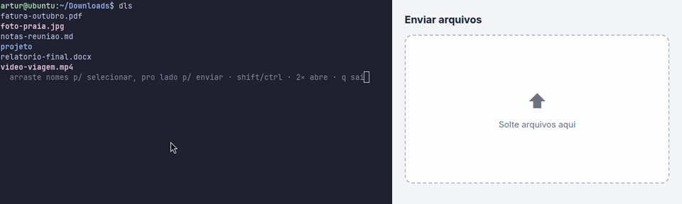
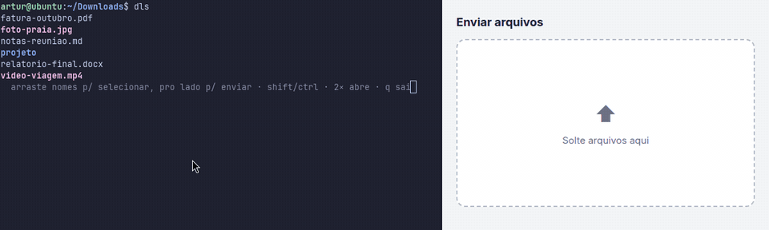

<div align="center">

**English** · [Português (Brasil)](README.pt-BR.md)

<h1>dls</h1>

<h3>The <code>ls</code> you can drag.</h3>

<p>List files as usual and drag them <b>straight out of the terminal</b> into your browser,<br>file manager, WhatsApp Web or any app that accepts files.</p>

<p>
<a href="LICENSE"></a>


<a href="https://github.com/ArturEndres/dls/stargazers"></a>
</p>



<p>
<a href="#installation"><b>Installation</b></a> ·
<a href="#usage"><b>Usage</b></a> ·
<a href="#how-it-works"><b>How it works</b></a> ·
<a href="#limitations"><b>Limitations</b></a>
</p>

<pre>git clone https://github.com/ArturEndres/dls.git && ln -s "$PWD/dls/dls" ~/.local/bin/dls</pre>

</div>

---

## Why

Terminals don't let you drag files *out*. To send a file through the browser, someone working in the terminal has to open the file manager, navigate to the same folder and only then drag it. `dls` removes that detour: the file you're looking at in the terminal can be dragged right from there.

## Features

- **Native drag** (XDND): works with any app that accepts dropped files.
- **Multi-select**: drag over the names (like selecting text), Shift+click for a range, Ctrl+click to toggle.
- **Visual cues**: the name under the mouse is highlighted (translucent with a compositor, solid without one, as in the demos), the cursor turns into a hand, the selection is shown in reverse video and the drag icon shows how many files are coming along.
- **Open**: double-click opens with the default app. Right-click shows an *open with…* menu listing the apps installed for that file type.
- **Keeps the `ls` look**: colors, columns, `-l`, `-h`, `-a` and the other display flags.
- **Lightweight**: a single Python file, nothing to install on a standard GNOME desktop. The listing shows up in ~30 ms and interaction is ready in ~150 ms.
- **Never leaves the terminal broken**: quitting with `q`, closing the tab or receiving `kill` all restore the terminal.

## Requirements

**Works out of the box:** Ubuntu and GNOME-based derivatives (Zorin, Pop!_OS…) on an X11 session, using gnome-terminal.
**Doesn't work:** Wayland sessions (the Ubuntu 22.04+ default) and terminals that don't use the gnome-terminal profile font (Konsole, xfce4-terminal, Ptyxis with its own font). In those cases `dls` doesn't break: it's just misaligned or falls back to `ls`.

| | |
|---|---|
| Session | **X11** (Ubuntu 22.04+ defaults to Wayland: pick *Ubuntu on Xorg* on the login screen) |
| Terminal | **gnome-terminal** (or another VTE-based terminal using the gnome-terminal profile font) |
| Python | 3.8+ |
| Libraries | PyGObject, pycairo, GTK 3 |

Ubuntu, Zorin, Pop!_OS, Fedora Workstation and other GNOME distros ship all of this already. If something is missing:

```bash
# Debian / Ubuntu
sudo apt install python3-gi python3-gi-cairo gir1.2-gtk-3.0

# Fedora
sudo dnf install python3-gobject python3-cairo gtk3
```

## Installation

```bash
git clone https://github.com/ArturEndres/dls.git
cd dls
ln -s "$PWD/dls" ~/.local/bin/dls
```

`~/.local/bin` must be on your `PATH` (it already is on Ubuntu and derivatives). To check:

```bash
command -v dls
```

To uninstall, just `rm ~/.local/bin/dls`.

## Usage

```bash
dls                  # current folder
dls -lh ~/Downloads  # accepts ls flags
dls *.pdf            # only files matching the pattern
dls -a               # include hidden files
```

While open, `dls` takes over the terminal screen, like `less`: the terminal has no scrollback to move the list out from under the highlight. When you quit, the listing is printed in the terminal just like `ls`. Files are laid out in columns like `ls`; with `-l` or `-1`, one per line.

### Mouse



| Action | Result |
|---|---|
| Hover over a name | highlights the name; the cursor turns into a hand |
| Press on a name and move **sideways** | drags that file |
| Press and move **up/down** | selects the files you pass over in that column (the first movement decides between dragging and selecting) |
| …then leave the column sideways | drags everything selected |
| Click | selects just that file |
| Shift + click | selects the range from the last click |
| Ctrl + click | adds to or removes from the selection |
| Drag a file that's already selected | drags the whole selection |
| Double-click | opens with the default app |
| Right-click | *open with…* menu |
| Mouse wheel | scrolls the list |

### Keyboard

| Key | Result |
|---|---|
| `↑` `↓` `PgUp` `PgDn` `Home` `End` | scroll the list |
| `a` | select all |
| `Esc` | clear the selection (with nothing selected, quit) |
| `q` / `Ctrl+C` | quit |

### Outside an interactive terminal

With output redirected (`dls | grep x`) or without a graphical display (SSH, TTY), `dls` behaves exactly like `ls`. `ls` errors (a missing path, for example) are shown and the exit code is preserved.

## How it works

No program running *inside* a terminal can start a drag: while the button is held, X11 hands the pointer to the terminal window. `dls` works around this:

1. **Mouse tracking.** `dls` turns on the terminal's mouse tracking mode (`?1003` + `?1006`). From then on, the terminal reports which cell (row, column) the mouse is in.
2. **Calibration.** The cell size comes from your gnome-terminal profile font, measured with Pango the same way VTE (gnome-terminal's engine) measures it. The grid's position on screen is deduced by matching each terminal event with the real pointer position. Each event narrows the origin down to an interval, and the intersection converges to the exact pixel within a few movements.
3. **Transparent window.** A borderless, semi-transparent window is placed exactly over the name under the mouse. It, not the terminal, receives the click, so the drag is a native GTK/XDND drag.
4. **Selection.** Kept inside `dls` and drawn in the terminal itself with ANSI sequences (reverse video).
5. **Full screen.** The list is drawn on the terminal's alternate screen (`?1049`), which has no scrollback: the scrollbar and `Shift+PgUp` can't move the list behind `dls`'s back, so the highlight is always over the right file.

## Limitations

- **X11 only.** On Wayland, a window can't place itself at absolute coordinates or read the global pointer position. On a Wayland session `dls` warns and behaves like `ls`.
- **Terminal zoom** (`Ctrl +` / `Ctrl -`) or a non-default profile misaligns the highlight, since the measurement comes from the default profile font. `dls` notices it and shows a warning in place of the help line.
- **Sorting:** the listing is always alphabetical. Flags like `-t` and `-S` are ignored.
- **Flags with a separate argument** (`-I pattern`, `-w 80`) are passed to `ls`, but the argument isn't treated as a draggable file. Files hidden by `-I` still show up as draggable.
- **While open**, `-l` doesn't show the `total` line and several folders aren't split under headers. The listing printed on exit has both.
- **If the terminal is left blank or prints numbers when you click** (only happens if `dls` is killed with `kill -9`), restore it with `reset` or with:

  ```bash
  printf '\e[?1003l\e[?1006l\e[?1004l\e[?7h\e[?25h\e[?1049l'
  ```

## Development

The project is a single executable file (`dls`) plus an automated check:

```bash
python3 test_dls.py   # prints "ok"
```

The test covers flag parsing, the file list and its order, the column layout (checked against `ls -C`), grid calibration, terminal input reading and the help line. The graphical part was validated in a nested X server (Xephyr) with a real VTE terminal and a mouse simulated through XTest.

## License

[MIT](LICENSE) © 2026 Artur Endres
